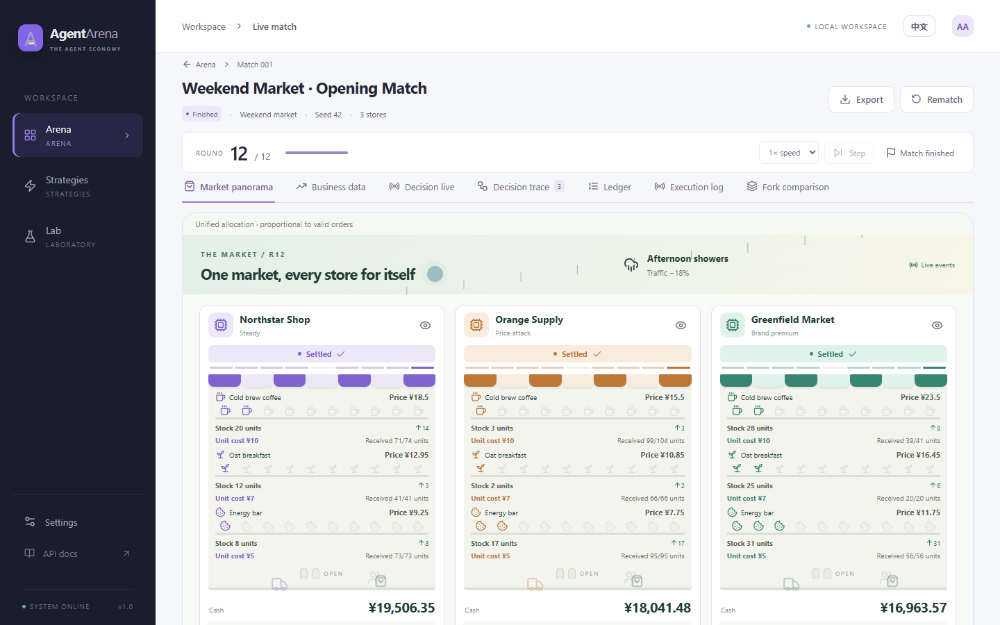
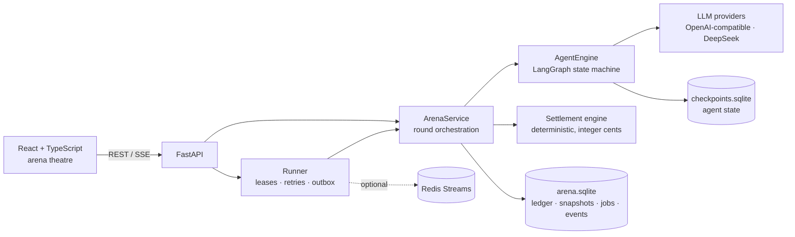
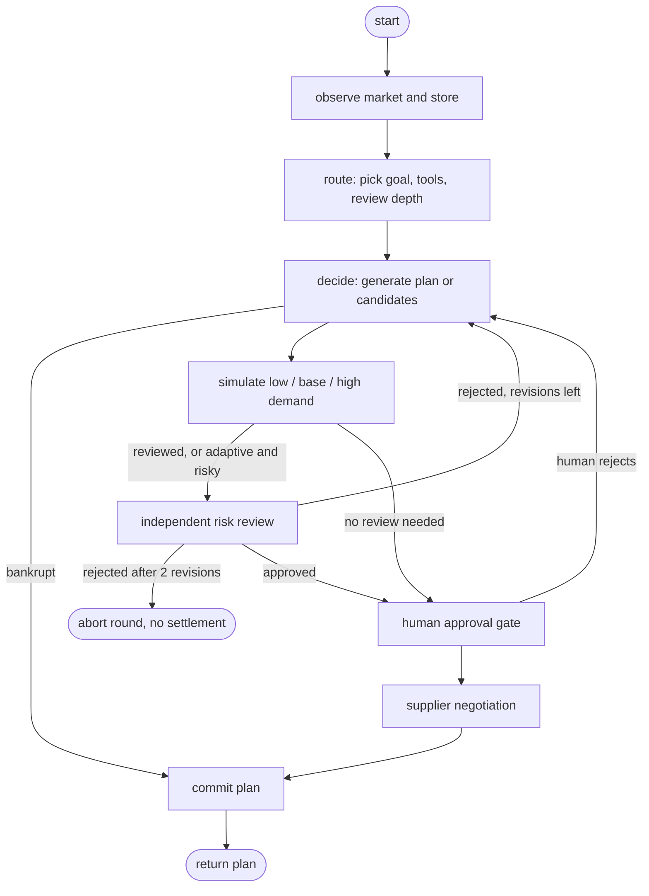
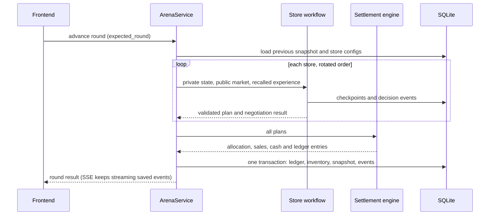
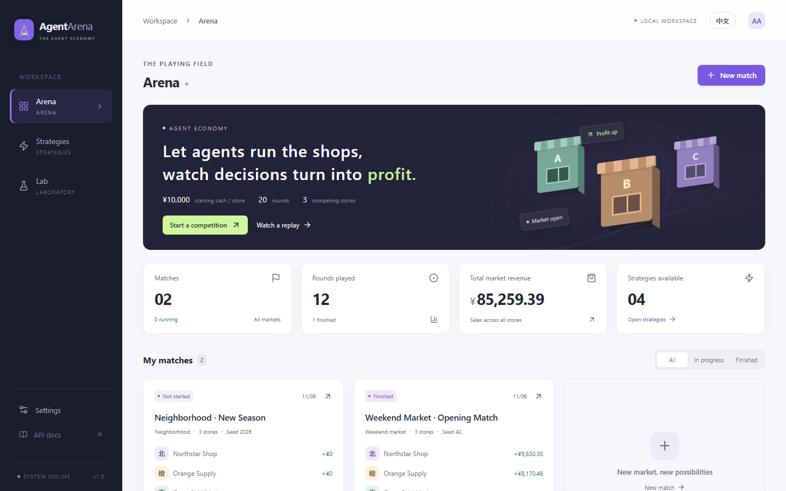

# AgentArena

[](https://github.com/ljx1230/AgentArena/actions/workflows/ci.yml)


**A multi-agent business simulation where LLM agents run competing stores, and every decision is checked against a deterministic ledger.**

[中文说明](README.zh-CN.md)



Two to four stores sell cold brew, oat breakfast and energy bars in one shared market. Each round, every store's agent observes
its own books plus competitors' public prices, then proposes prices, restocking and marketing spend. It can also negotiate
with a supplier. A deterministic engine then clears wholesale supply, simulates customer purchases, and settles cash and
inventory in integer cents. Profit, stock-outs and cash flow are the ground truth that agents, memories and workflows are
measured against.

The core rule: **models propose, the engine disposes.** An LLM never mutates money or inventory directly. Plans are
schema-validated, stress-tested and optionally reviewed by a separate agent or a human before the settlement transaction runs.

## Highlights

- **Agent workflows on LangGraph.** There are three modes: *direct* (one plan), *reviewed* (several candidates, a
  three-scenario projection, and an independent reviewer agent with up to two automatic revisions) and *adaptive* (a planner
  decides how deep to go based on market and inventory risk).
- **Bounded tool use.** Tool budgets are enforced in agent middleware: query tools run at most once each, the projection
  tool at most twice, and a hard per-plan cap applies on top. Plans are validated with Pydantic, through JSON mode or
  tool-based structured output.
- **Multi-agent negotiation.** Buyer and supplier agents exchange an RFQ, offers and counter-offers, then accept or reject. The supplier's
  private floor price is never visible to the buyer. Agreed orders are cleared together with everyone else's by
  largest-remainder proportional allocation, so submission order gives no advantage.
- **Human-in-the-loop.** Risky plans (or every plan, if configured) pause on a LangGraph `interrupt`. The approval is
  persisted, and the human can approve, edit or reject. Edits are re-validated against available cash. Optimistic
  versioning rejects approvals of stale proposals.
- **Evidence-based episodic memory.** Settled rounds are stored as context/action/outcome records, including the
  forecast-vs-actual error. They are recalled by similarity of market event, demand, cash and stock. Memory is scoped to
  one match, so development and holdout seeds can't leak into each other.
- **Durable execution.** Jobs live in SQLite with a transactional outbox. Workers hold fenced leases (owner plus
  `lease_version`) with heartbeats, so a crashed worker's job is taken over without double settlement. Redis Streams can
  optionally replace the polling queue.
- **Live decision theatre.** Node starts and finishes, tool calls and settlements are persisted as events and streamed over
  SSE. A single replay timeline drives animations for all stores, and animation never blocks the backend.
- **Evaluation harness.** Fixed seeds, seat rotation, and development/holdout seed splits (overlap is rejected) support
  ablations over model, memory, review and planning strategy. Reported metrics include profit spread, paired seed deltas,
  stock-out rate, drawdown, tokens, cost estimates and latency.

## Architecture



### Per-store decision graph



Some nodes call models and others are plain code. Projection runs locally, and rule-based stores make no model calls at all.

### One round, end to end



## Reliability and correctness

| Concern | Mechanism |
| --- | --- |
| Double settlement | `expected_round` compare-and-set inside `BEGIN IMMEDIATE`, plus unique constraints on `(arena, round, store)` |
| Worker crash after a model call | Inner and outer LangGraph checkpoints, so a resumed job reuses finished plans instead of calling the model again |
| Zombie workers | Fenced leases: every write asserts `owner` and `lease_version`, and a stale worker raises `LeaseLost` |
| Lost queue messages | Transactional outbox, published to Redis Streams or polled from SQLite |
| Money rounding | All amounts are integer cents, and inventory cost uses book-value COGS |
| Prompt injection via tool output | Tools return data only, the system prompt says tool output is not instructions, and plans are schema-validated |
| Runaway tool loops | Middleware hides exhausted tools and forces a final answer when the budget is spent |

## Quick start

Requires Python 3.11+ and Node.js 20.19+.

```bash
git clone https://github.com/ljx1230/AgentArena.git
cd AgentArena
bash setup.sh      # Windows PowerShell: ./setup.ps1
bash start.sh      # Windows PowerShell: ./start.ps1
```

Open **http://127.0.0.1:8010**. The first launch plays a rule-based demo match and creates an empty one for you to start.
Rule-based stores need no API key. To use LLM agents, add a model connection under **Settings**: base URL, model name and
API key. Any OpenAI-compatible endpoint with function calling works, and a dedicated DeepSeek adapter preserves
`reasoning_content` across tool calls in thinking mode.



The UI follows the browser language (English or Chinese) and remembers the toggle in the top bar.

For frontend development, run `npm run dev --prefix frontend` (port 5178, proxied to the API on 8010). API docs are served at
`/api/docs`.

### Configuration

Copy `.env.example` to `.env`, or configure models in the UI. `.env` only seeds the database on first run.

| Variable | Default | Notes |
| --- | --- | --- |
| `ARENA_HOST` / `ARENA_PORT` | `127.0.0.1` / `8010` | |
| `ARENA_DATA_DIR` | `./data` | Business DB and checkpoint DB |
| `ARENA_EXECUTION` | `embedded` | Set `external` to run workers via `python -m arena.worker` |
| `REDIS_URL` | empty | Empty uses the SQLite-polled queue |
| `MODEL_BASE_URL` / `MODEL_NAME` / `MODEL_API_KEY` | OpenAI / empty / empty | |

To run the stack with Redis and separate workers: `docker compose up --build -d` (add `--profile workers` for workers).

## Testing

```bash
.venv/bin/python -m pytest -q              # 90 backend tests: settlement, leases, workflows, negotiation, API
.venv/bin/ruff check arena tests           # lint
.venv/bin/ruff format --check arena tests  # formatting
npm run test:i18n --prefix frontend        # every UI string has a translation, no hard-coded Chinese
npm run build --prefix frontend            # TypeScript strict and production build
npm run test:browser --prefix frontend     # Playwright end-to-end run against a throwaway database
```

CI runs all of these on every push and pull request. Regular tests never call paid models. Live-model acceptance runs are
explicit opt-ins:

```bash
.venv/bin/python -m arena.cli.benchmark   # free, reproducible rule-based baseline
.venv/bin/python -m arena.cli.live_test --key-file key.txt --model deepseek-flash --workflow adaptive --steps 2
```

## Project layout

```text
arena/
  api/             FastAPI routes, SSE, export, static frontend
  application/     Round orchestration, transactions, snapshots, forks
  agents/          LangGraph engine, tools, review, memory, negotiation, approvals
  domain/          Market model, procurement clearing, projections, settlement
  execution/       Durable jobs, leases, retries, worker dispatch
  infrastructure/  SQLite, config, event bus
  evaluation/      Metrics, strategy selection, holdout validation
  cli/             Baseline benchmark and live-model acceptance
frontend/src/      React app: arena theatre, decisions, ledger, experiments
  i18n/            English source strings, Chinese dictionary, server-text mapping
tests/             Backend regression and protocol tests
```

## Roadmap

- [x] Lint, formatting and CI
- [x] English / Chinese UI with a persistent language toggle
- [ ] Locale-aware backend text (agent prompts, rule summaries, seeded demo data)
- [ ] Concurrent per-store planning, with p50/p95 round latency measured before and after
- [ ] OpenTelemetry tracing for graph nodes, tool calls and model calls
- [ ] Hosted demo with authentication, rate limiting and server-side secret management
- [ ] Native Anthropic and OpenAI providers, and a cross-model leaderboard

## Limitations

This is a single-workspace local app: there are no accounts or tenant isolation yet. It listens on loopback only, and model
API keys are stored in the local SQLite database. Results are simulated business data. With identical seeds, rule-based runs
are reproducible; LLM runs are not guaranteed to be.
